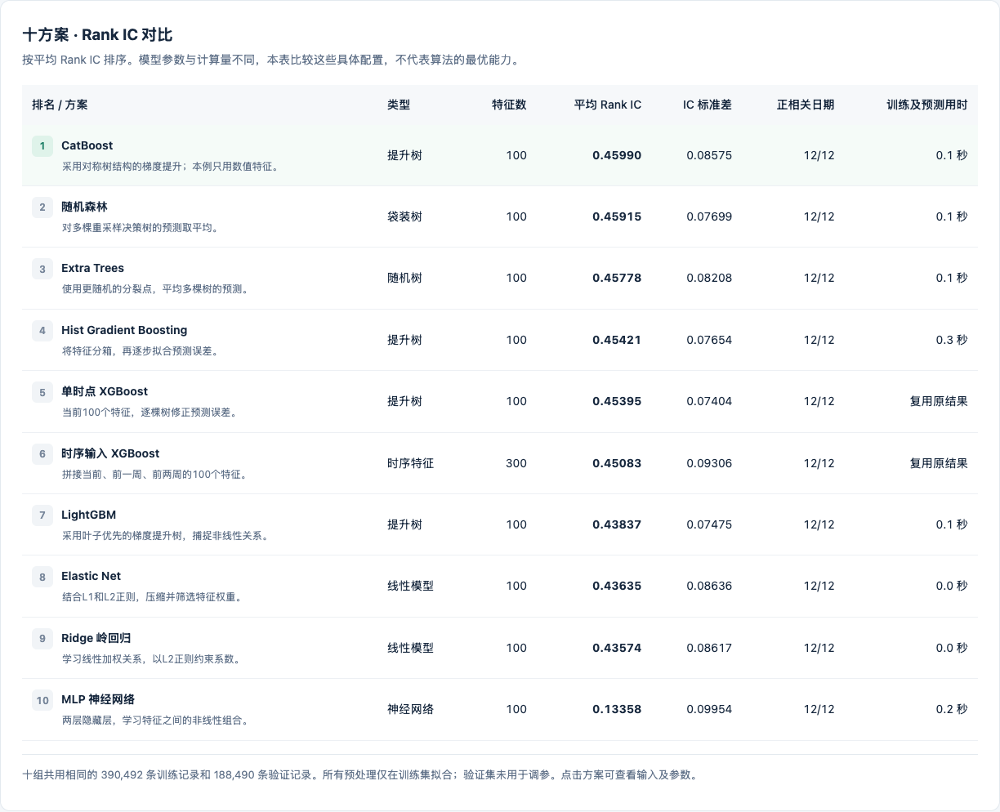
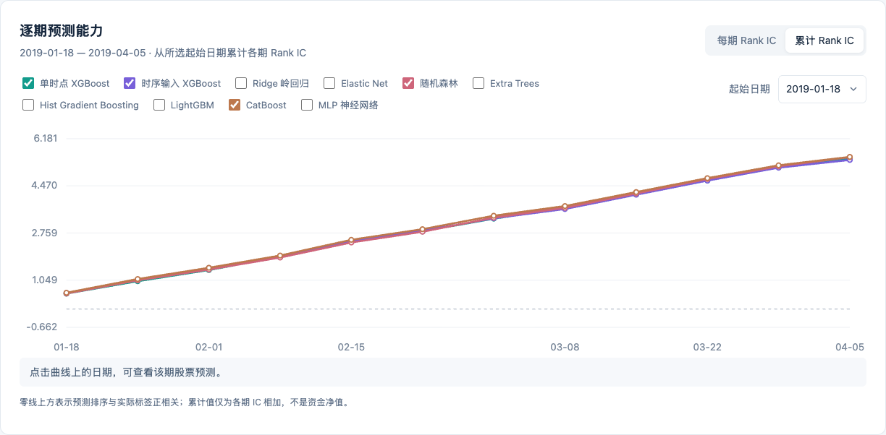
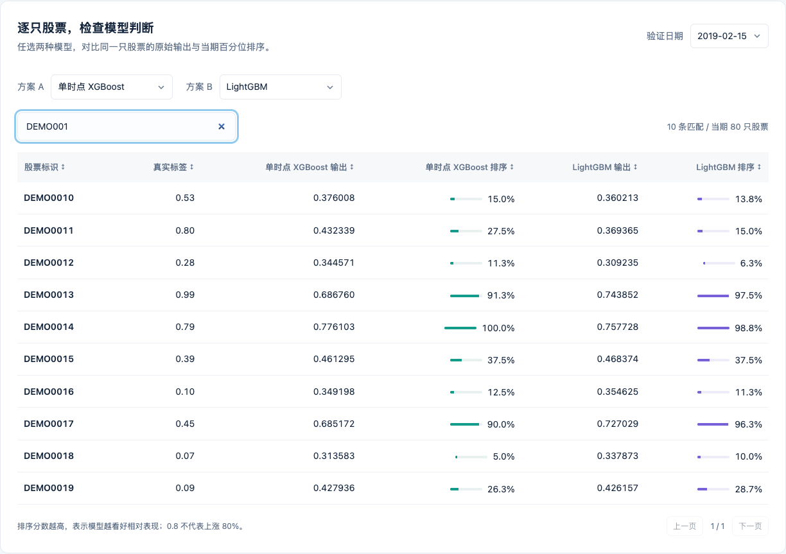
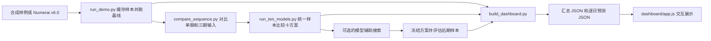

# Numerai 预测研究 v1.0

这个项目把单时点 XGBoost、加入历史快照的 XGBoost 和其他八种模型方案放到同一组历史样本上比较。看板展示各期的排序表现，并允许按日期和标的查看两种模型给出的原始预测与当期百分位。仓库附带由合成样本生成的看板，可以先体验完整流程。

## 查看演示

在仓库目录运行：

```sh
python3 -m http.server 8000 --bind 127.0.0.1 --directory dashboard
```

打开 [本地研究看板](http://127.0.0.1:8000)。通过 HTTP 启动是因为 [dashboard/app.js](dashboard/app.js) 需要按日期加载 JSON 明细。

## 实际使用截图

### 模型排名

查看合成样例中各模型的排名和验证指标。



### 累计 Rank IC

将图表切换到累计 Rank IC，观察不同模型在验证区间的表现。



### 同一期预测对比

选定一期后对比 XGBoost 与 LightGBM 的预测，可以继续按样例标的筛选。



## 复现顺序

推荐 Python 3.13。下面的流程会在单独的工作目录生成合成数据、训练结果和网页。

```sh
python3 -m venv .venv
. .venv/bin/activate
python -m pip install -r requirements.txt

export NUMERAI_WORK_DIR="$PWD/work/synthetic"
python generate_demo_data.py
python run_demo.py
python compare_sequence.py
python run_ten_models.py
python build_dashboard.py
python -m http.server 8000 --bind 127.0.0.1 --directory "$NUMERAI_WORK_DIR/dashboard"
```



| 按顺序运行 | 输入和输出 |
| --- | --- |
| [generate_demo_data.py](generate_demo_data.py) | 固定种子生成虚构标的、日期和特征，写入 `data/` 的 Parquet、特征清单和合成数据标记 |
| [run_demo.py](run_demo.py) | 读取合成标记或下载 Numerai v6.0 指定列，缓存早期训练和后期验证样本；训练初始 XGBoost，将模型、逐期分数和本地预测 CSV 写入 `results/` |
| [compare_sequence.py](compare_sequence.py) | 按同一标的和日期拼接当前、7 天前及 14 天前的特征，在相同样本上对比两种 XGBoost；把模型和逐行预测写入 `sequence_results/` |
| [run_ten_models.py](run_ten_models.py) | 复用两种 XGBoost 预测并校验日期、标的与标签对齐；训练另外八种固定方案，将同一批验证行的预测、各期分数和配置报告写入 `ten_results/` |
| [build_dashboard.py](build_dashboard.py) | 读取上述报告和预测，生成 `dashboard/data/summary.json` 与按日期命名的明细 JSON；汇总文件将初始基线标成独立参考 |
| [dashboard/index.html](dashboard/index.html) · [dashboard/app.js](dashboard/app.js) | 展示平均分排名、逐期或累计曲线，以及按日期筛选的两模型逐标的预测对比 |

[paths.py](paths.py) 统一解析输出目录。通过 `NUMERAI_WORK_DIR` 为合成样本与真实行情各设一个目录，可以同时保留两套产物。

## 样本和评分口径

- **预测目标**使用 `target_jupiter_60`。基础数据按周观察，训练和验证按时间切开，基线脚本校验两段之间间隔超过 180 天。
- **时序输入**按标的精确匹配 7 天前和 14 天前的记录，只取历史特征。十方案比较统一保留这两期特征都有记录的样本，使单时点模型也在同一批行上评分。
- **十种方案**包括两种 XGBoost、Ridge、Elastic Net、随机森林、Extra Trees、直方图梯度提升、LightGBM、CatBoost 和 MLP。
- **Rank IC**是在每个日期内计算各标的预测与标签的 Spearman 秩相关，再对各日期取平均。页面也可以显示预测在同一天的百分位。该指标描述历史样本中的排序关系，交易收益和 Numerai 官方中性化评分有各自的计算口径。
- **本地预测文件**由初始 XGBoost 写入 `results/submission.csv`，使用 `numerai_ticker,prediction` 两列；流程止于本地文件生成。

## 使用 Numerai 数据

创建一个独立空目录，设置 `NUMERAI_WORK_DIR`，从 `python run_demo.py` 开始，随后运行时序对比、十方案和看板脚本。真实数据路径通过 Numerai 公共接口取得数据地址，再读取所需列及数据块。本机目录会保存数据、模型和评分结果。

```sh
export NUMERAI_WORK_DIR="$PWD/work/numerai"
mkdir -p "$NUMERAI_WORK_DIR"
python run_demo.py
python compare_sequence.py
python run_ten_models.py
python build_dashboard.py
```

## 可选的模型辅助搜索与留出验证

1. 在本机通过 `DEEPSEEK_API_KEY` 配置自己的模型密钥，可用 `DEEPSEEK_MODEL` 或 `--model` 选择模型。标准十方案流程可直接在本机运行。
2. [agent_search.py](agent_search.py) 读取十方案的开发期结果和 [agent_knowledge.json](agent_knowledge.json)，经 [llm_client.py](llm_client.py) 和 [deepseek_client.py](deepseek_client.py) 请求 JSON 配方。本地代码校验模型类别、参数区间和集成权重，然后训练或合并预测，在开发期评分。
3. 搜索结束后将选中的配置、开发期报告指纹和冻结时间保存到 `agent_results/frozen_selection.json`。真实数据路径用 [prepare_agent_test.py](prepare_agent_test.py) 准备后期样本。
4. [evaluate_agent_holdout.py](evaluate_agent_holdout.py) 核对冻结指纹，在同一后期样本上对冻结方案与固定基线评分，写入 `final_test.json` 和逐行预测。随后重建看板可查看这部分结果。
5. 如需比较官方基准预测，[compare_official_benchmark.py](compare_official_benchmark.py) 在有对应开发与留出结果的真实数据目录中运行，按日期和标的对齐官方预测，用同一 Rank IC 口径输出本地报告。
